

  

# Recreator-3D---Firmwares-for-mk5-mk6-builds

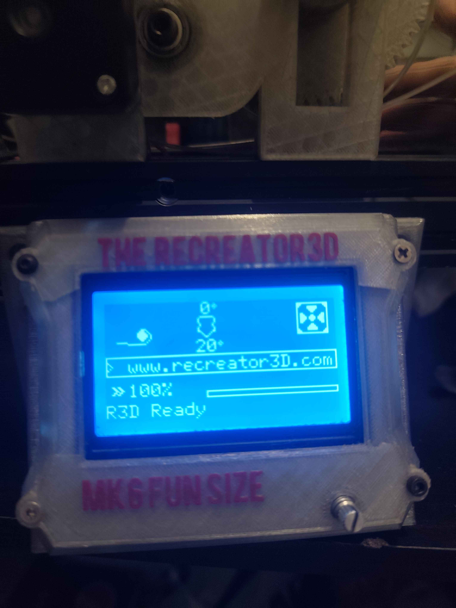

Various combo mobo + screen for latest R3D firmwares - www.recreator3D.com

# 
# What are the features?

-Marlin 2.1.2.7

-Custom BootScreen,Status Screen,InfoScreen;

-Bed icon removed

-Status icon replaced by Pultrude icons - pultrude anim,

-X,Y,Z replaced by >www.recreator3D.com

-Inbuilt Pultrude OPT, thanks to @JoshuaTaylor inbuilt Pultrude program 

(infinite Pultrude command, once launched, need to be stoped -either way-)

-STOP and PAUSE button,

-Pultrude Speed Selection (really slow up to 1800)

-Pultrude Materia Select (rPet, HDPE , PLA, PETG, PP) 

-Selectable Spinning Dir (Roll) to adjust Spooler dir, making this fw compatible mk5/mk6

-Allow for 3 different languages, right from the menu, English, French, Spanish,

-In case none work here is a R3D Command Menu

-Support for Filaruptor, varying in fw

-PID AutoTune

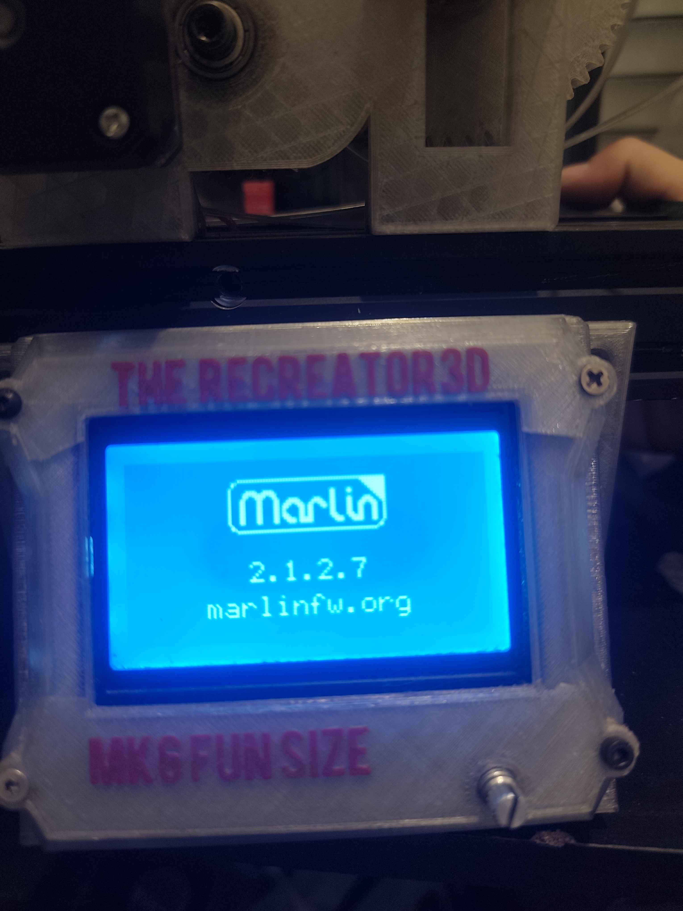

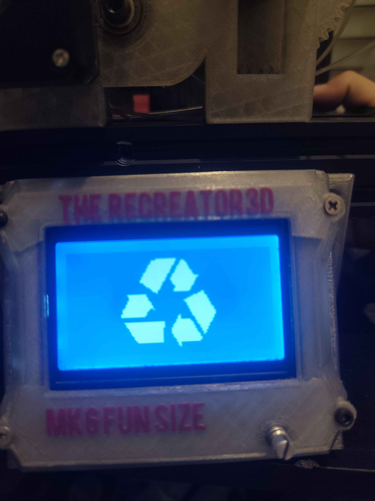

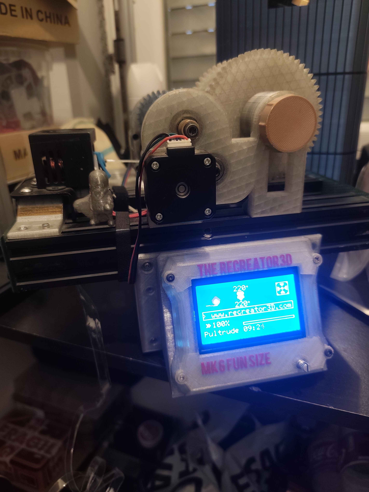

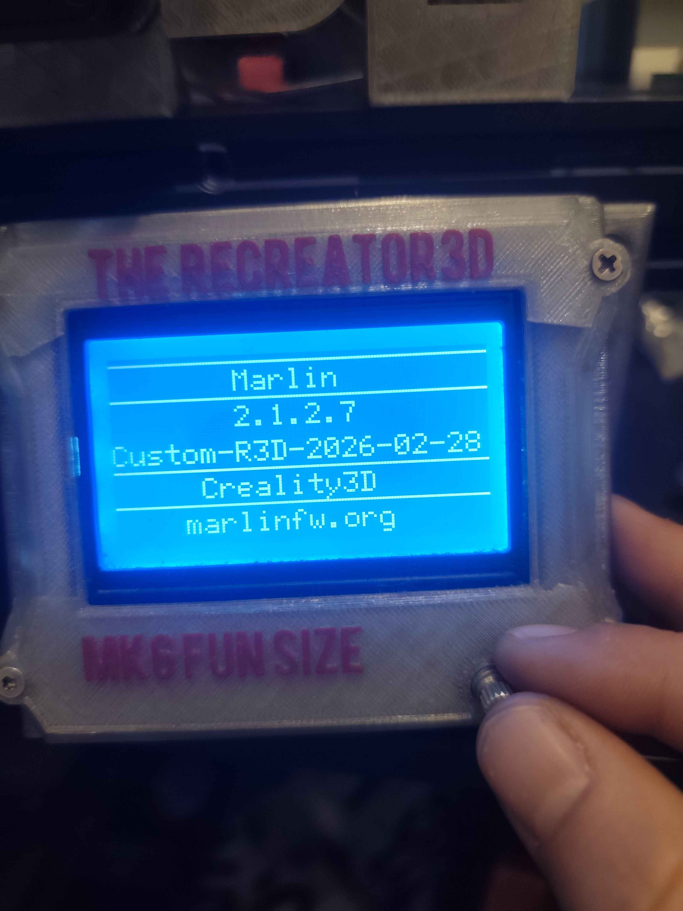

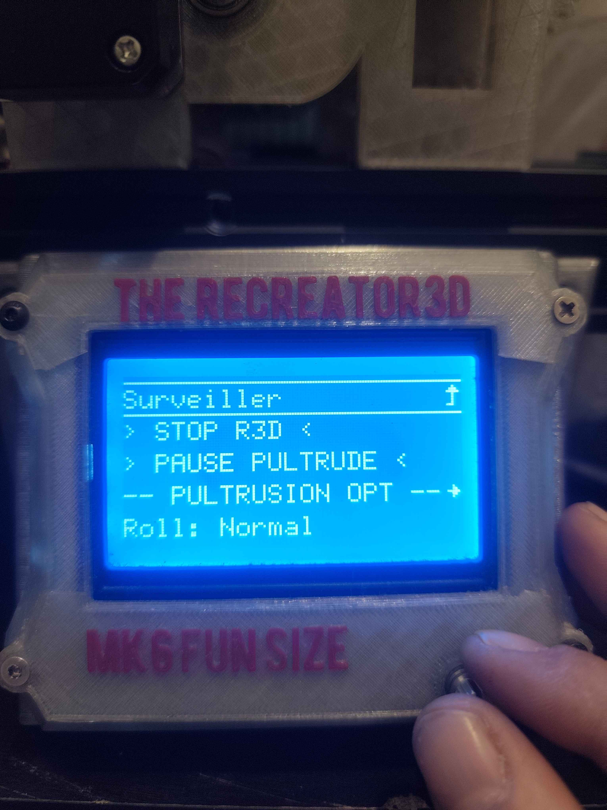

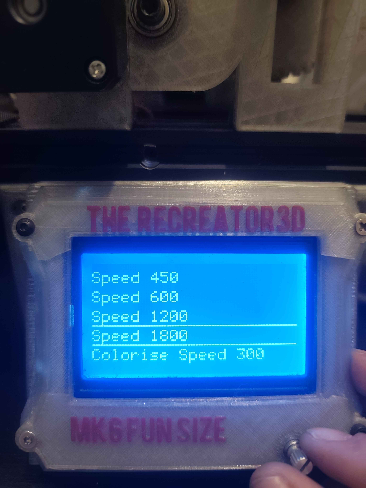

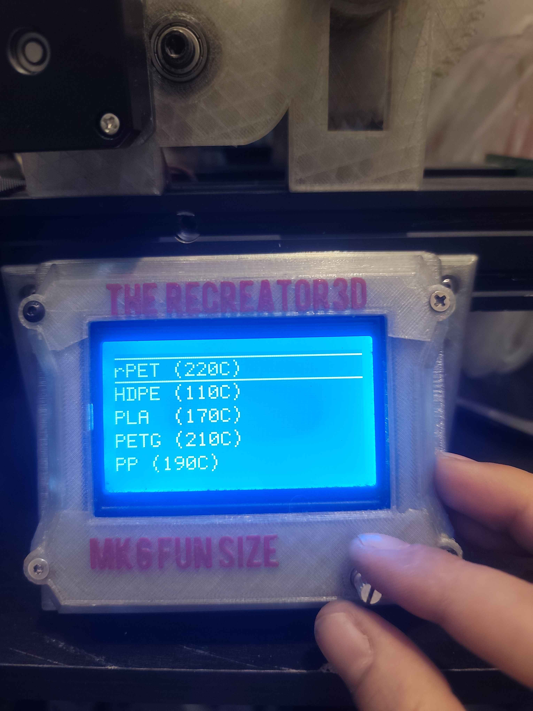

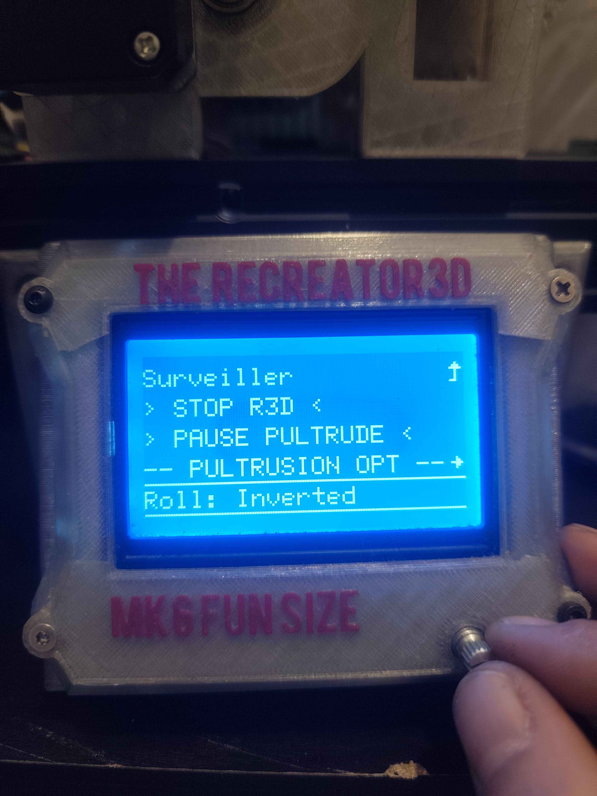

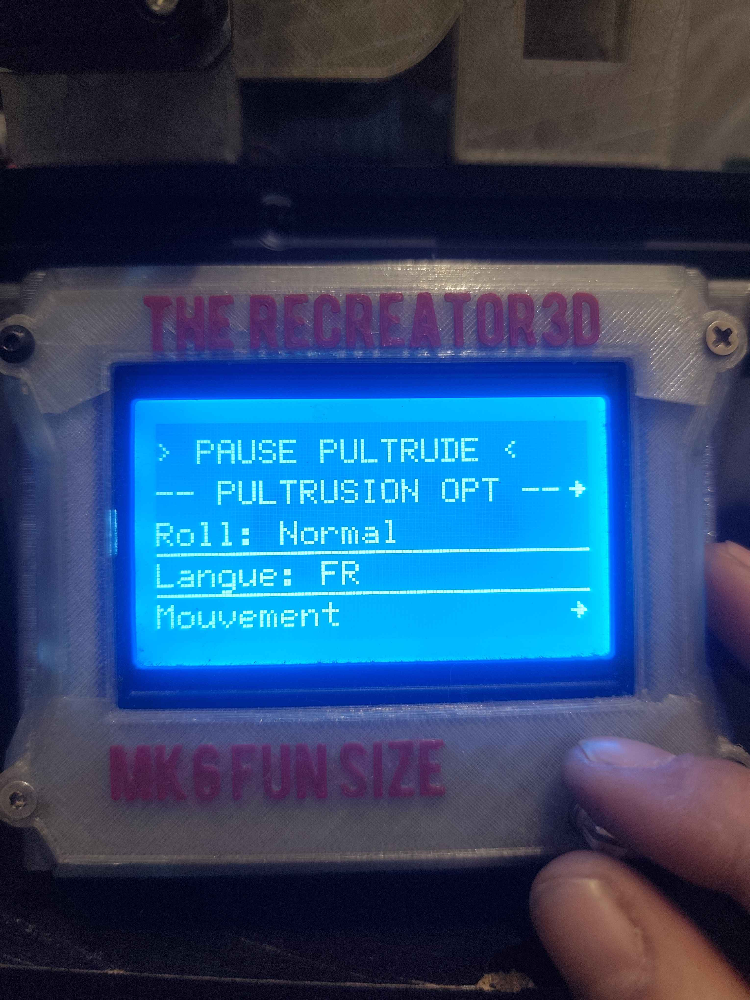

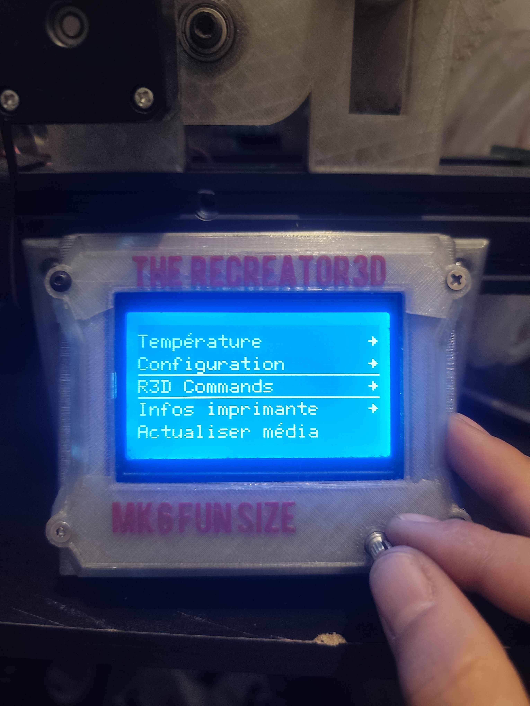

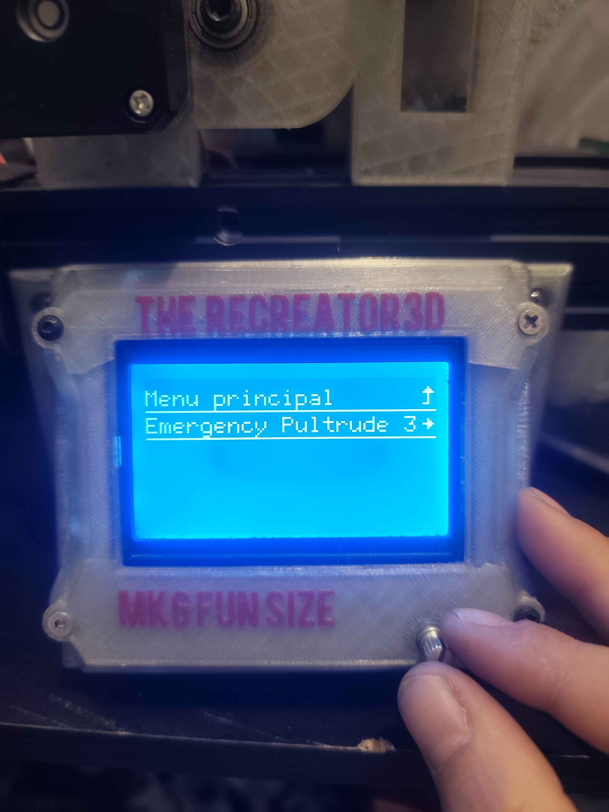

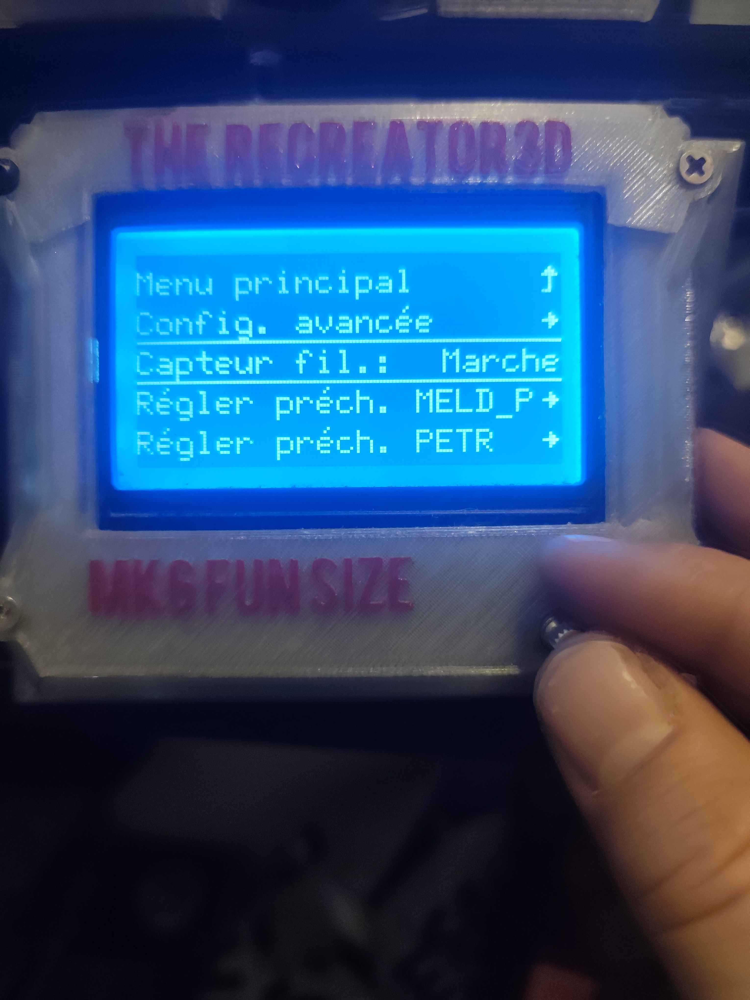

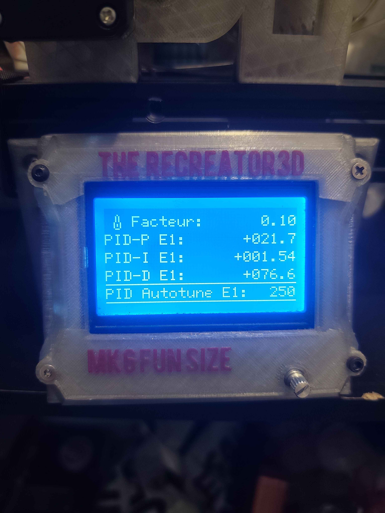

# 
# Reminders:

MK5
https://www.recreator3d.com/mk5kitender3

MK5 Printable link
https://www.printables.com/model/179820-recreator-3d-mk5kit-ender3-pultrusion-unit?lang=fr

MK6
https://www.recreator3d.com/mk6funsize

MK6 Printable link
https://www.printables.com/model/352729-the-recreator-3d-mk6-diy-bom-turn-pet1-plastic-bot?lang=fr
# 
# FIRMWARES
# 
# Anet1.7

2.1.2.7 Anet 1.7 + ReprapSmart Screen;

---> firmwareAnet1.7.elf

# 
# BTT

2.1.2.7 Octopus 1.1 + E3Pro Screen;

optimized for dual pultruding!

---> firmwareOctopus1.1dual.zip

2.1.2.7 SkrMiniE3v1 + BttMini12864v2 Screen;

---> firmwareSkrMiniE3v1.1.bin

2.1.2.7 SkrMiniE3v2 + BttMini12864v2.1 Screen;

---> firmwareSkrMiniE3v2.bin

2.1.2.7 SkrMiniE3v3 + E3Pro Screen;

---> firmwareSkrMiniE3v3.bin

# 
# Cheetah

2.1.2.7 1.1b Cheetah + E3Pro Screen;

---> firmwareCheetah1.1b.elf

# 
# Creality 1.1.3 and 1.1.4

2.1.2.7 113 + E3Pro Screen;

---> firmwareCreality1.1.3.elf

2.1.2.7 114 + E3Pro Screen;

---> firmwareCreality1.1.4.elf

# 
# Creality 4.2.2 GD all variants

2.1.2.7 422 GD A + E3Pro Screen;

---> firmwareCreality4.2.2_GD_A.bin

2.1.2.7 422 GD B + E3Pro Screen;

---> firmwareCreality4.2.2_GD_B.bin

2.1.2.7 422 GD C + E3Pro Screen;

---> firmwareCreality4.2.2_GD_C.bin

2.1.2.7 422 GD E + E3Pro Screen;

---> firmwareCreality4.2.2_GD_E.bin

2.1.2.7 422 GD H + E3Pro Screen;

---> firmwareCreality4.2.2_GD_H.bin

2.1.2.7 422 GD H8 + E3Pro Screen;

---> firmwareCreality4.2.2_GD_H8.bin

# 
# Creality 4.2.2 STM all variants

2.1.2.7 422 STM A + E3Pro Screen;

---> firmwareCreality4.2.2_STM_A.bin

2.1.2.7 422 STM B + E3Pro Screen;

---> firmwareCreality4.2.2_STM_B.bin

2.1.2.7 422 STM C + E3Pro Screen;

---> firmwareCreality4.2.2_STM_C.bin

2.1.2.7 422 STM E + E3Pro Screen;

---> firmwareCreality4.2.2_STM_E.bin

2.1.2.7 422 STM H + E3Pro Screen;

---> firmwareCreality4.2.2_STM_H.bin

2.1.2.7 422 STM H8 + E3Pro Screen;

---> firmwareCreality4.2.2_STM_H8.bin

2.1.2.7 422 STM T8 + E3Pro Screen;

---> firmwareCreality4.2.2_STM_T8.bin

# 
# Creality 4.2.7

2.1.2.7 427 + E3Pro Screen;

---> firmwareCreality4.2.7.bin

# 
# Creality 4.3.1

2.1.2.7 431 + E3Pro Screen;

---> firmwareCreality4.3.1.bin

# 
# Elegoo

2.1.2.7 Robin Nano 1.2 + E3Pro Screen;

---> firmwareElegooRobinNano1.2.bin

2.1.2.7 Robin Nano 1.3 + E3Pro Screen;

---> firmwareElegooRobinNano1.3.bin

# 
# MKS

2.1.2.7 MKS Gen L1 + E3Pro Screen;

---> firmwareMKSGenL1.elf

2.1.2.7 MKS Robin + E3Pro Screen;

---> firmwareMKSRobin_e3.bin

2.1.2.7 SV06 + CR10 Screen;

---> firmwareSV06.bin
